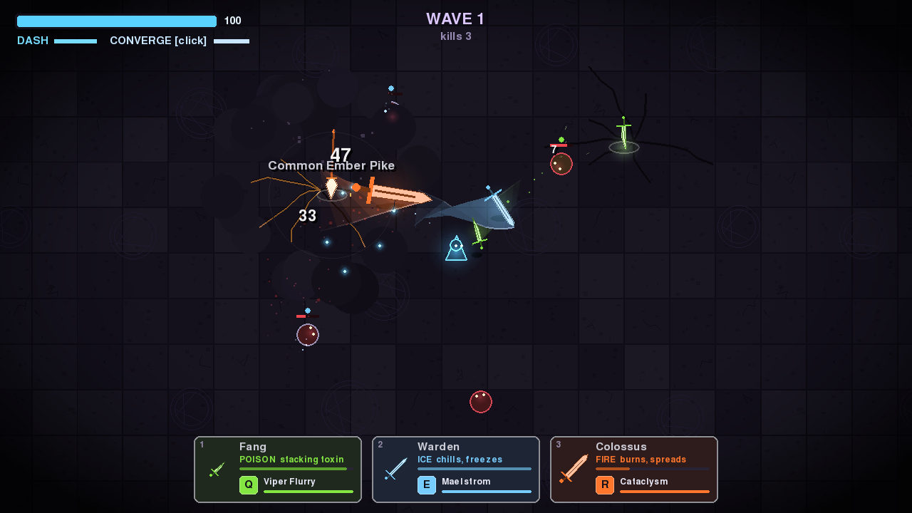
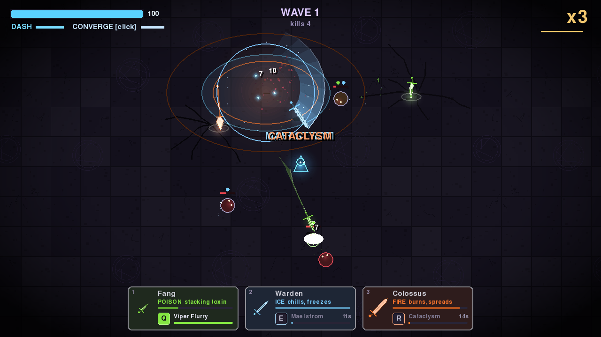

# Swordster

**A proof-of-concept arena survival game where three spirit swords fight for you.**

Move through waves of enemies while your swords attack on their own. Dash out of
danger, command a coordinated strike, and trigger each sword's ultimate. Defeat
armed enemies to claim their weapons and experiment with different sword and
element combinations.

Swordster is a playable prototype exploring this combat loop. Mechanics, balance,
and presentation are experimental and may change.



Built with Python and Pygame, playable on desktop or in a browser via Pygbag.
Created in [T3 Code](https://t3.codes).

## Quick start

Run these commands from the repository root with Python 3 installed:

```bash
python3 -m venv .venv
.venv/bin/pip install pygame-ce pygbag
```

These commands use a macOS/Linux virtual environment. On Windows, use
`.venv\Scripts\python.exe` and `.venv\Scripts\pip.exe` instead.

### Desktop

```bash
.venv/bin/python game/main.py
```

### Browser

```bash
.venv/bin/python serve.py
```

Open **http://localhost:8000** and click the page when prompted to start.
The browser downloads its Python/Pygame runtime from Pygbag's CDN, so the first
load needs internet access and may take a moment.

Restart the server after editing the game to rebuild, then refresh your browser.
Press **Ctrl+C** to stop the server. See [Sharing the browser demo](#sharing-the-browser-demo)
for server options and remote access.

## How to play

- **Survive the waves.** Position yourself while your three swords attack nearby enemies automatically.
- **Direct the action.** Use Converge to send all three swords to one point, or trigger individual ultimates.
- **Change your loadout.** Defeat armed enemies, approach their dropped swords, and swap one into a slot.
- **Combine elements.** Each sword carries fire, ice, or poison; its hits apply that element's effect.

### Keyboard and mouse

| Action | Control |
| --- | --- |
| Move | WASD or arrow keys |
| Dash | Space or Shift |
| Converge at the cursor | Left or right click |
| Trigger ultimate for slot 1 / 2 / 3 | Q / E / R |
| Swap a nearby dropped sword into slot 1 / 2 / 3 | 1 / 2 / 3 |
| Toggle attack ranges | Tab or G |
| Pause / resume | P or Escape |
| Toggle help | H |
| Restart after death | R |

Targeted ultimates land at the cursor; skill shots fire toward it.

### Touch controls

In the browser on a smartphone, use the left joystick to move and **DASH** to
evade. **STRIKE** converges on the nearest enemy; tap the arena to aim at a
specific point. **ULT 1/2/3** triggers that sword's ultimate at the nearest enemy,
and **SLOT 1/2/3** swaps a nearby dropped sword into that slot.

Touch buttons also provide pause, restart, range display, and fullscreen where
supported. Rotate to landscape for a larger arena. Switching away from the
browser pauses the game; tap **PAUSE** to resume.

## Swords and elements

Each sword has its own automatic attack and one manually triggered ultimate.
You equip three swords at a time, choosing from four types:

| Sword | Automatic attack | Ultimate | Effect |
| --- | --- | --- | --- |
| Fang | Close, rapid strikes | Viper Flurry | Blinks to the cursor and darts between nearby enemies |
| Warden | Sweeping arcs at medium range | Maelstrom | Whirls at the cursor, pulls enemies in, then bursts outward |
| Pike | Long, piercing thrusts | Skewer | Fires toward the cursor, carrying enemies into walls |
| Colossus | Slow, crushing slams | Cataclysm | Slams at the cursor and leaves elemental ground behind |



*Gameplay screenshots captured from the proof of concept.*

A sword's color shows its element. Any sword type can carry any element:

| Element | Effect |
| --- | --- |
| Fire | Burns enemies and spreads to neighbours on death |
| Ice | Slows enemies and freezes them after four stacks; frozen enemies cannot hurt you and take extra damage |
| Poison | Stacks damage over time |

## Sharing the browser demo

`serve.py` builds the browser game before serving it. Its optional flags are:

| Flag | Purpose |
| --- | --- |
| `--no-build` | Serve an existing build without rebuilding |
| `--port 8080` | Use a different port; the default is 8000 |
| `--host 0.0.0.0` | Listen on all interfaces for access from another device on your network |

For a local network demo:

```bash
.venv/bin/python serve.py --host 0.0.0.0
```

On the other device, open `http://<server-local-ip>:8000` using this computer's
local network IP address.

For a remote demo over Tailscale, bind to this computer's Tailscale address:

```bash
.venv/bin/python serve.py --host "$(tailscale ip -4)"
```

Open `http://<server-tailscale-ip>:8000` from a device connected to your tailnet.

## Project layout

- [`game/main.py`](game/main.py) — game logic, rendering, and synthesized audio.
- [`serve.py`](serve.py) — browser build and demo server.
- [`web/`](web/) — browser touch controls and mobile styling.
- [`screenshots/`](screenshots/) — gameplay images used in documentation.
